# Calcusome

A fast, keyboard-first calculator for **macOS** and **iPad**, with exact decimal math, a searchable history you can bookmark and label, and five themes.

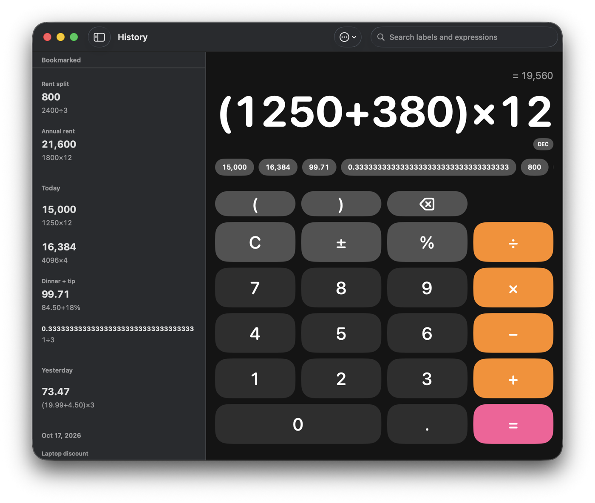

## Features

### Calculator
- **Exact decimal math.** Every number and operation is rounded to 34 significant digits (half-even), so `0.1 + 0.2` is `0.3` and not `0.30000000000000004`.
- **Live result while you type.** The answer appears above the expression (`= 19,560`) before you press `=`.
- **Parentheses, percent, ± and backspace.** Percent works the way people expect: `200 + 10%` is `220`, and `50%` on its own is `0.5`.
- **Recent-result chips.** The last 8 results sit under the display. Tap one to drop it into the current expression.
- **Clear errors.** You see *Incomplete*, *Can't divide by 0* or *Too large* instead of a silent `NaN`.
- **Paste anything.** ⌘V on Mac, or long-press the display on iPad. `1,250 * 12`, `1.250,5 x 3` (in a comma-decimal locale) and Arabic-Indic, Persian or Bengali digits are all cleaned up into a valid expression.
- **Locale aware.** Results use your region's decimal and grouping separators.

### Result formats
Show a result as **Decimal, Fraction, Hexadecimal, Binary or Octal**. Pick one from the badge under the result or from Settings. History always keeps the exact decimal value. When a result can't be shown in the chosen format (say, a fraction in hex), the badge dims and the decimal is shown instead.

| Fraction | Hexadecimal |
|---|---|
| 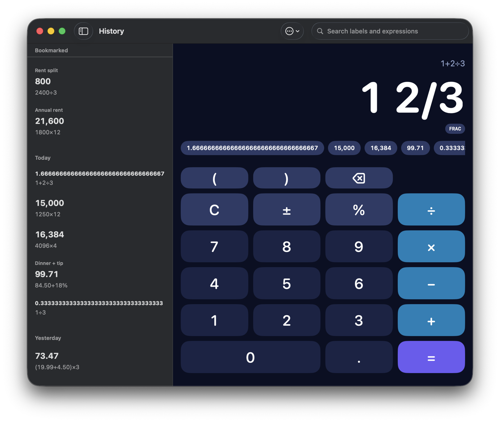 | 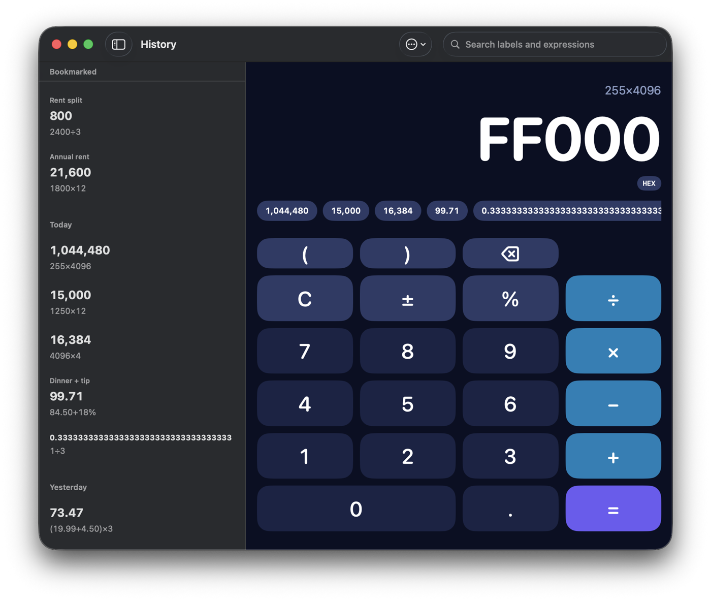 |

### History
- Every calculation is saved and grouped into **Bookmarked**, **Today**, **Yesterday** and then by date.
- **Click a result** to insert it into the current expression. **Click the expression under it** to insert the whole expression (in parentheses when you are mid-calculation).
- **Right-click** a row (or swipe it on iPad) to **Bookmark**, **Label…**, **Copy Result** or **Delete** it.
- **Search** across labels and expressions.
- **Export to CSV** or **Clear History** from the ⋯ menu. Clearing keeps your bookmarks.
- **Auto clear** history after 1, 7 or 30 days (bookmarks are kept).
- Every window has its own input but shares one history, and all windows update together.

| Row actions | Search |
|---|---|
| 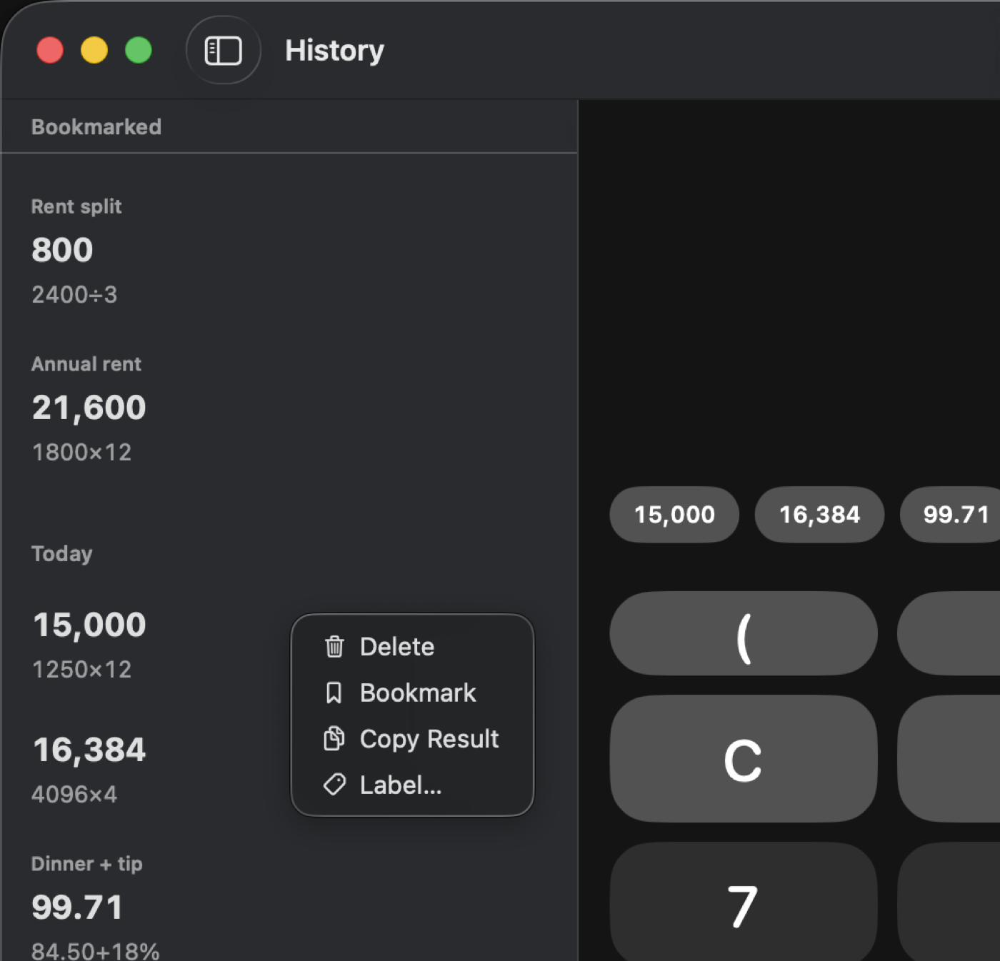 | 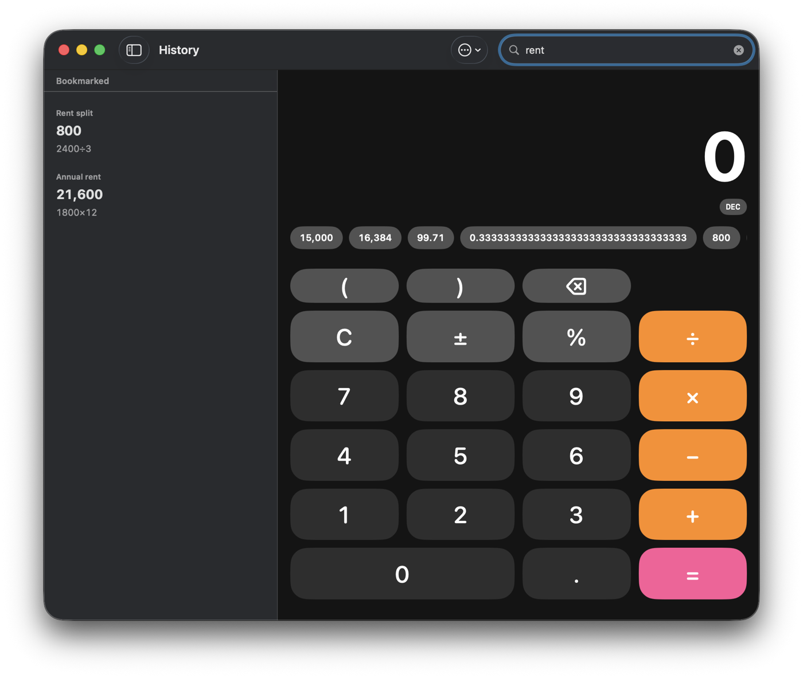 |

### Themes
Five themes: **Graphite, Paper, Midnight, Terminal and Bloom**. Each one sets the window's light or dark appearance to match. There are also three display sizes: Small, Medium and Large.

| Graphite | Paper | Midnight |
|---|---|---|
| 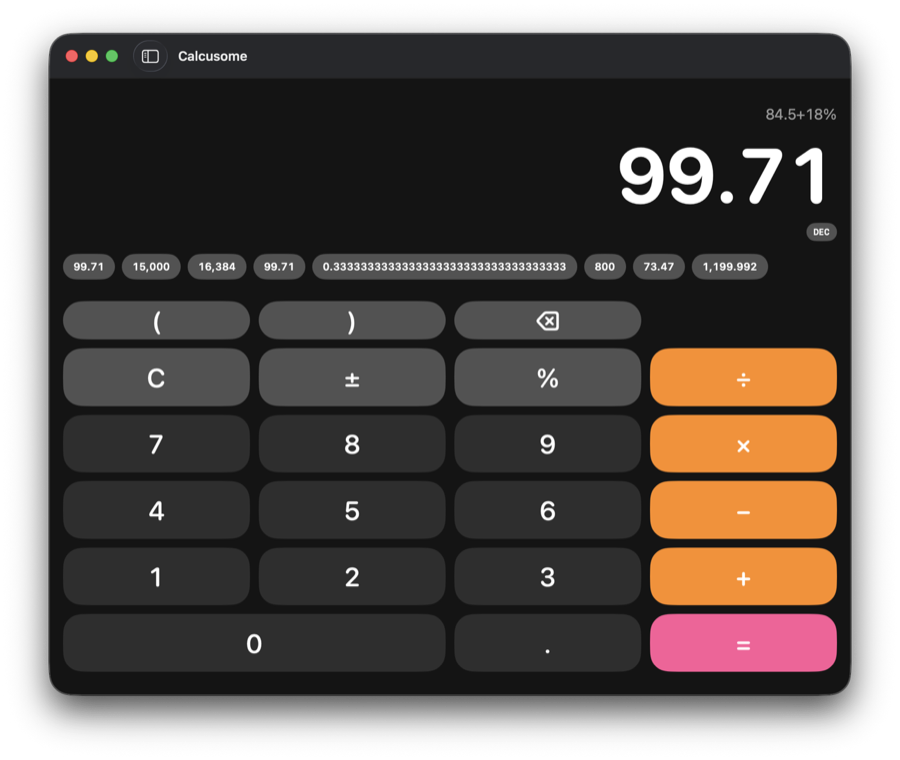 | 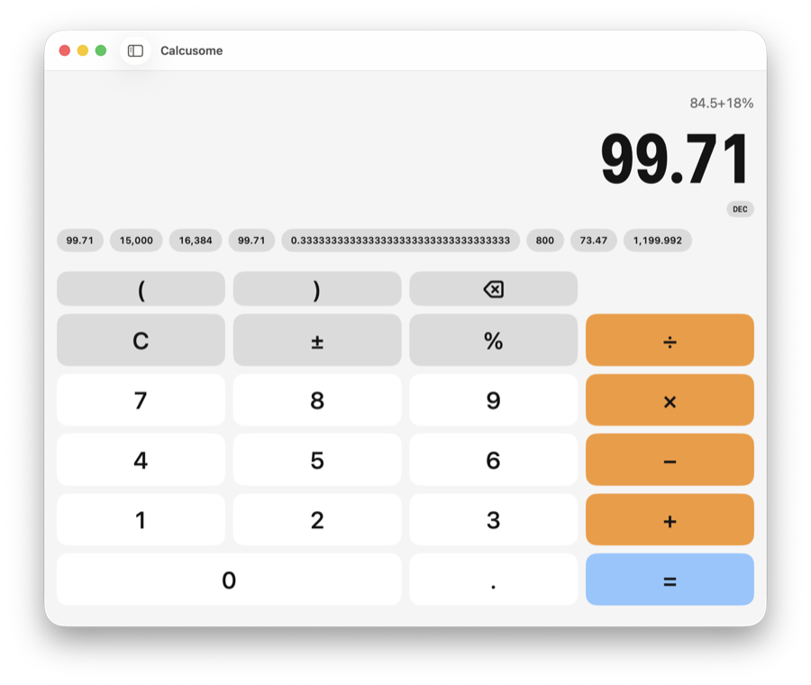 | 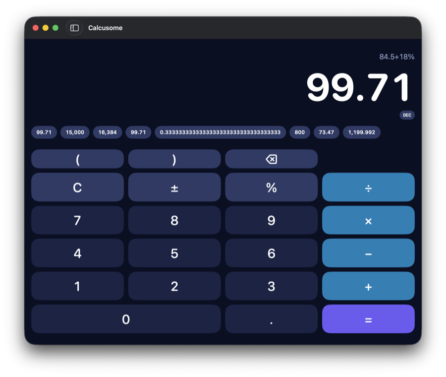 |

| Terminal | Bloom |
|---|---|
| 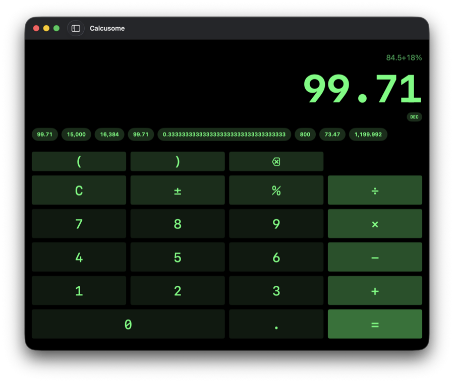 | 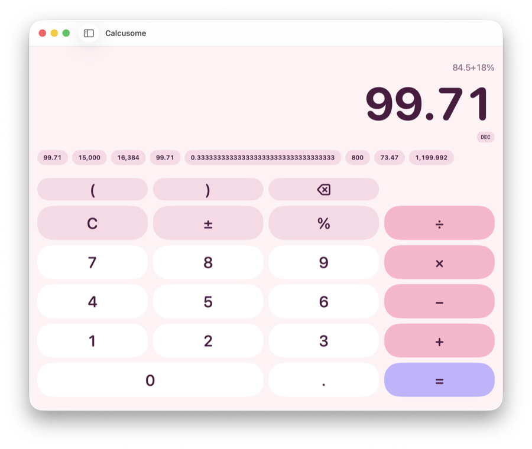 |

### Mac extras
- **Menu bar calculator.** A full calculator in a menu bar popover that shares the same history.
- **Global shortcut ⌥⌘=** brings Calcusome to the front from any app. It needs no Accessibility permission.
- **Hide the history sidebar** with ⌃⌘S, or the sidebar button, for a compact calculator.

### Settings
Open them with ⌘, on Mac, or the gear button on iPad.

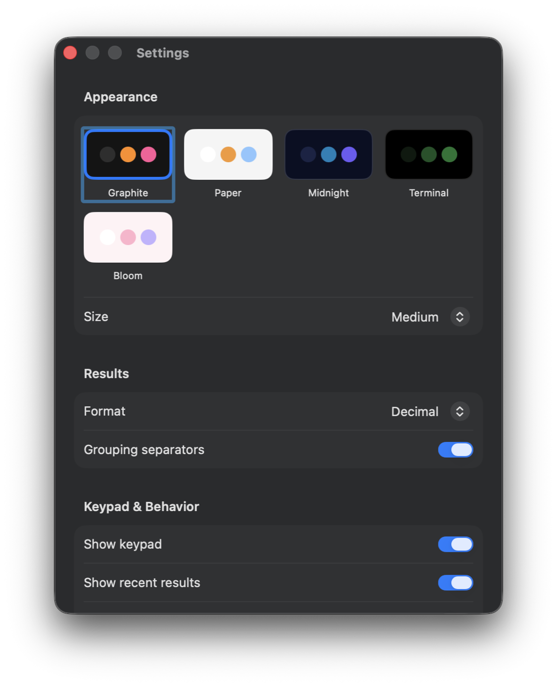

| Section | Options |
|---|---|
| Appearance | Theme, Size (Small / Medium / Large) |
| Results | Format (Decimal / Fraction / Hex / Binary / Octal), grouping separators |
| Keypad & Behavior | Show keypad, show recent results, copy result on `=` |
| History | Auto clear (Never / 1 / 7 / 30 days), Export…, Clear History… |
| Mac | Menu bar calculator, global shortcut ⌥⌘= |

Turn off **Show keypad** to get a display-only calculator you drive from the keyboard.

### Keyboard

| Key | Action |
|---|---|
| `0`–`9` `.` | Digits and decimal point (`,` too, where your locale uses it) |
| `+` `-` `*` `x` `/` `%` `(` `)` | Operators (`*` and `x` become ×, `/` becomes ÷) |
| `Return` / `=` / numpad Enter | Evaluate |
| `Delete` | Backspace |
| `Esc` | Clear |
| `⌘V` | Paste an expression (Mac) |
| `⌃⌘S` | Show / hide history |
| `⌘,` | Settings (Mac) |
| `⌥⌘=` | Bring Calcusome to the front from anywhere (Mac) |

## Install (unsigned build)

Calcusome isn't notarized or on the App Store yet. The Mac app is only **ad-hoc signed**, so macOS Gatekeeper will block it the first time you open it. The steps below cover how to get past that.

**Requirements:** macOS 15 Sequoia or later. Building from source also needs Xcode 26 or later and [XcodeGen](https://github.com/yonaskolb/XcodeGen).

### Option A: build it yourself (recommended)

```bash
brew install xcodegen
```

```bash
git clone https://github.com/kmsharif/Calcusome.git && cd Calcusome/apple/App && xcodegen
```

```bash
xcodebuild -scheme Calcusome -configuration Release -destination 'platform=macOS' -derivedDataPath DerivedData build
```

```bash
cp -R DerivedData/Build/Products/Release/Calcusome.app /Applications/
```

An app you built on your own Mac isn't quarantined, so it opens normally.

### Option B: you were given a `Calcusome.app` (zip, AirDrop, download)

1. Unzip it and drag **Calcusome.app** into **Applications**.
2. Double-click it. macOS will say it *"cannot be opened because Apple cannot check it for malicious software"* (or *"…is damaged"*). Click **Done** / **Cancel**.
3. Open **System Settings → Privacy & Security**, scroll to **Security**, and click **Open Anyway** next to the Calcusome message. Confirm with your password or Touch ID.
4. Open Calcusome again and click **Open**. From now on it opens normally.

If **Open Anyway** doesn't appear, or macOS insists the app is *damaged*, remove the quarantine flag from Terminal instead:

```bash
xattr -dr com.apple.quarantine /Applications/Calcusome.app
```

Only do this for a copy you trust, from a source you know.

### iPad

iPadOS can't install unsigned apps, so the app has to be signed with your own Apple ID:

1. Run `xcodegen` in `apple/App` and open `Calcusome.xcodeproj` in Xcode.
2. Under **Signing & Capabilities**, choose your personal team. If the bundle ID `com.calcusome.app` is taken, change it to something unique.
3. Plug in your iPad (iPadOS 18 or later), select it as the run destination and press **Run**.
4. On the iPad, trust the developer certificate in **Settings → General → VPN & Device Management**.

Apps signed with a free Apple ID expire after 7 days. Run from Xcode again to refresh it.

### Accounts & sync

Sign-in and history sync need a Supabase backend. Until a hosted project is set up, `apple/App/Sources/Sync/SupabaseConfig.swift` points at a local stack: run `npx -y supabase start` from the repo root (Google sign-in also needs `GOOGLE_CLIENT_ID` and `GOOGLE_CLIENT_SECRET` set for real Google OAuth credentials). Without a backend, the calculator and history work as before, on this device only.

### Sign in with Apple (optional)

Sign in with Apple only works with a paid Apple Developer team, so it's off by default. To turn it on, copy `apple/App/Signing.local.xcconfig.example` to `apple/App/Signing.local.xcconfig` and replace `YOUR_TEAM_ID` with your team ID. That file is git-ignored. Without it, the Apple button can't sign you in; use Google instead.

## Development

```
apple/
  CalcCore/   Swift package: engine, exact decimal, input normalizing, formats, history store
  App/        SwiftUI app for macOS + iPadOS (project generated by XcodeGen from project.yml)
spec/         Shared math test cases (JSON), generated by spec/generate_cases.py
```

Run the core tests:

```bash
swift test --package-path apple/CalcCore
```

CI (`.github/workflows/apple.yml`) runs those tests and builds the app for macOS and iOS on every push.
